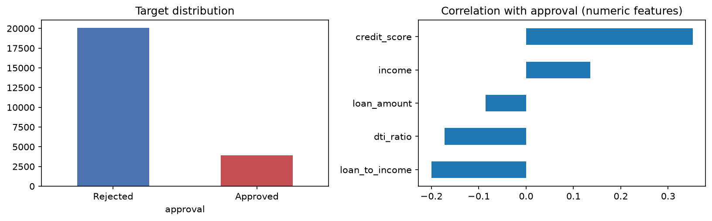
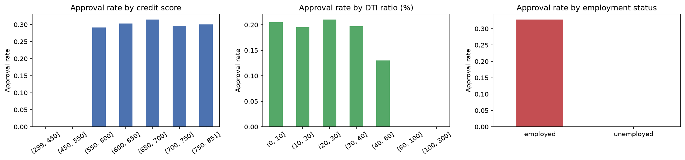
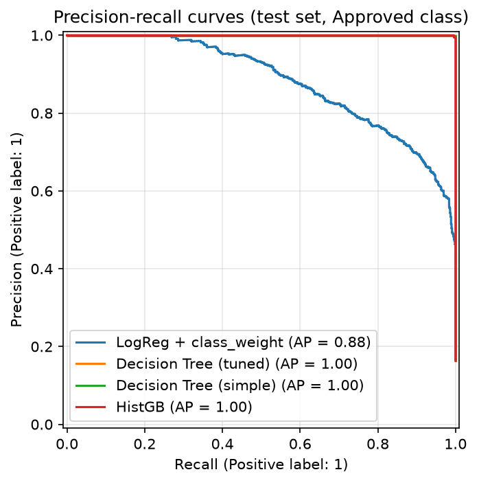
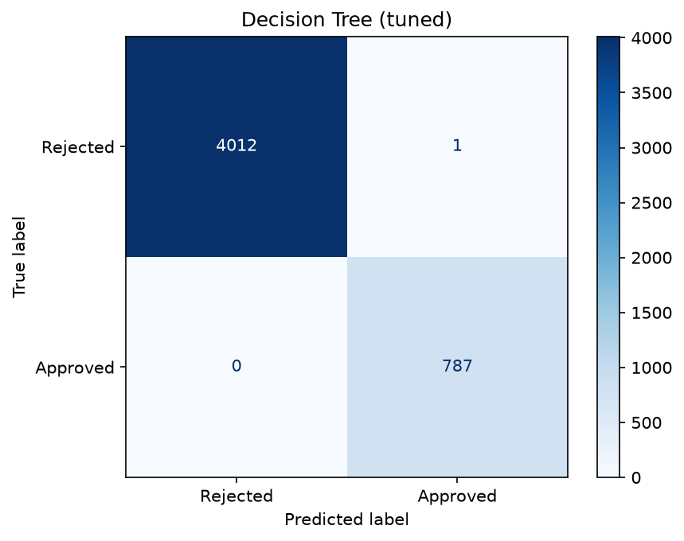
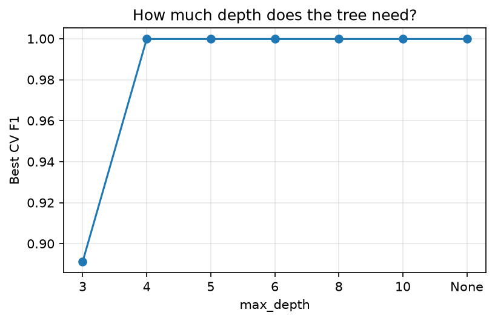
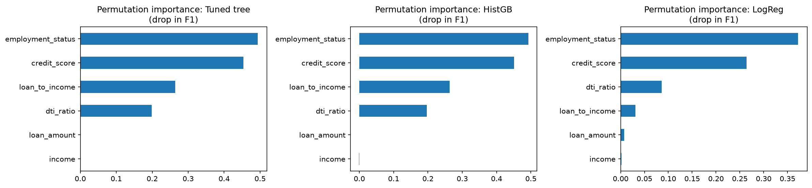

# Loan Approval Prediction

A binary classification project that predicts whether a loan application will be **approved or rejected**, with a focus on evaluating models correctly on **imbalanced data** (precision, recall, F1 of the Approved class) instead of relying on accuracy.

Built as **Task 1 (Level 2, Machine Learning track)** of the Elevvo Internship Program.

---

## Table of Contents
- [Project Overview](#project-overview)
- [Dataset](#dataset)
- [Approach](#approach)
- [Results](#results)
- [Key Findings](#key-findings)
- [Project Structure](#project-structure)
- [Getting Started](#getting-started)
- [Limitations](#limitations)
- [Future Work](#future-work)
- [Author](#author)

---

## Project Overview

**Goal:** Build a classifier that predicts loan approval from applicant and loan features, and evaluate it with metrics that make sense when roughly 5 in 6 applications are rejected.

**What this project covers**
- Schema validation and data-quality checks (implausible DTI values, missing values, duplicates)
- Leak-free preprocessing pipelines: imputation, scaling, one-hot encoding, and TF-IDF for the free-text loan purpose
- A **feature-set ablation** that decides, using cross-validation, whether the text column and an engineered `loan_to_income` ratio earn a place in the final model
- Logistic Regression vs Decision Tree vs Gradient Boosting
- Imbalance handling: `class_weight="balanced"` and SMOTE
- Hyperparameter tuning, plus a search for the **simplest tree** that matches the best one
- Decision-threshold tuning driven by a business objective (precision on approvals)
- Error analysis, permutation importance, and a stress test that removes the dominant feature
- Evidence that the models **rediscover the hidden approval rules** from training data alone

**Tech stack:** Python 3.12, pandas, scikit-learn, imbalanced-learn, matplotlib, Jupyter

---

## Dataset

- **Source:** [Loan approval dataset (Kaggle)](TODO-paste-the-exact-Kaggle-link)
- **Size:** 24,000 rows x 7 columns
- **Target:** `Approval` (Approved = 1, Rejected = 0)
- **Class balance:** 83.6% Rejected (20,067) / 16.4% Approved (3,933), roughly 5 : 1
- **Missing values:** none
- **Data-quality notes:** 1,255 rows (5.2%) have a DTI ratio above 100%. Income and credit score are almost perfectly uniformly distributed, which suggests synthetic data.

| Feature | Type | Description |
|---|---|---|
| `Text` | Free text | The applicant's stated loan purpose |
| `Income` | Numeric | Applicant income |
| `Credit_Score` | Numeric | Credit score |
| `Loan_Amount` | Numeric | Requested loan amount |
| `DTI_Ratio` | Numeric | Debt-to-income ratio (%) |
| `Employment_Status` | Categorical | Employment status |

**Hidden structure found in EDA:** every approved applicant is employed (all 12,007 unemployed applicants were rejected), has a credit score of at least 551, a DTI of at most 50, and a loan of at most 60% of income. The four rules combined reproduce **all 24,000 labels with zero errors** (precision 1.0, recall 1.0), which indicates synthetic, rule-generated data.

> The raw CSV is not included in this repository. Download it from Kaggle and place it in the project root as `loan_data.csv`.

---

## Approach

1. **Validation and cleaning:** normalised column names, stripped whitespace, asserted the expected schema and target values, and ran data-quality checks.
2. **EDA:** class balance, feature distributions, correlation with approval, and approval rate by credit-score band, DTI band and employment status (to see whether relationships are linear or threshold-like).
3. **Split:** stratified 80/20 train/test split (`random_state=42`). The test set was used only for final evaluation. Every earlier choice used 5-fold stratified cross-validation on the training set.
4. **Preprocessing (inside the pipeline, so there is no leakage):**
   - Numeric: median imputation, then standard scaling
   - Categorical: most-frequent imputation, then one-hot encoding
   - Text: TF-IDF (300 features, unigrams and bigrams), used only if the ablation justifies it
5. **Feature-set ablation:** compared `tabular`, `tabular + loan_to_income`, `tabular + text`, and `text only` using two probe models. A richer feature set is adopted only if it improves average CV F1 by more than 0.005.
6. **Models compared** (5-fold stratified CV on the training set):

   | Model family | Variants |
   |---|---|
   | Dummy baseline | always predict the majority class |
   | Logistic Regression | plain, `class_weight`, SMOTE |
   | Decision Tree | plain, `class_weight`, SMOTE |
   | Gradient Boosting (HistGB) | plain |

7. **Tuning:** grid search on the Decision Tree (`max_depth`, `min_samples_leaf`, `criterion`) optimizing F1, then the **simplest tree within 0.002 F1** of the best, which is easier to explain.
8. **Threshold tuning:** applied to Gradient Boosting. The threshold is chosen from out-of-fold training predictions to maximize recall subject to a target precision on Approved, taking the midpoint of the plateau of equally good thresholds.
9. **Analysis:** error analysis, permutation importance for three models, a stress test without `Credit_Score`, and a check that the tree rediscovers the eligibility cutoffs.

> SMOTE is applied through `imblearn.pipeline.Pipeline`, so it only touches training folds and never leaks into validation or test data.

---

## Results

**Selected feature set:** `tabular + loan_to_income`

### Feature-set ablation (5-fold CV on the training set)

| Feature set | LogReg (balanced) F1 | Tree (depth 8) F1 | Mean F1 | Tree ROC-AUC |
|---|---|---|---|---|
| tabular | 0.771 | 0.972 | 0.872 | 0.997 |
| **tabular + loan_to_income** | **0.781** | **0.9998** | **0.890** | **1.000** |
| tabular + text | 0.770 | 0.972 | 0.871 | 0.997 |
| text only | 0.249 | 0.000 | n/a | 0.500 |

### Cross-validation (training data, 5-fold, selected feature set)

| Model | Precision | Recall | F1 | ROC-AUC | PR-AUC |
|---|---|---|---|---|---|
| Tree + class_weight | 1.000 | 1.000 | 1.000 | 1.000 | 1.000 |
| Tree + SMOTE | 1.000 | 1.000 | 1.000 | 1.000 | 1.000 |
| Tree | 1.000 | 1.000 | 1.000 | 1.000 | 1.000 |
| HistGB | 0.997 | 0.997 | 0.997 | 1.000 | 0.999 |
| LogReg | 0.809 | 0.773 | 0.790 | 0.977 | 0.896 |
| LogReg + SMOTE | 0.665 | 0.949 | 0.782 | 0.977 | 0.891 |
| LogReg + class_weight | 0.662 | 0.951 | 0.781 | 0.977 | 0.891 |
| Dummy (always majority) | 0.000 | 0.000 | 0.000 | 0.500 | 0.164 |

### Final test-set performance (Approved class)

| Model | Threshold | Precision | Recall | F1 | ROC-AUC | PR-AUC |
|---|---|---|---|---|---|---|
| LogReg + class_weight | 0.50 | 0.637 | 0.948 | 0.762 | 0.974 | 0.881 |
| Decision Tree (tuned) | 0.50 | 0.999 | 1.000 | 0.999 | 1.000 | 0.999 |
| **Decision Tree (simple, depth 4)** | 0.50 | 0.999 | 1.000 | 0.999 | 1.000 | 0.999 |
| HistGB | 0.50 | 0.996 | 0.996 | 0.996 | 1.000 | 1.000 |
| HistGB, tuned threshold | ~0 | 0.975 | 1.000 | 0.987 | 1.000 | 1.000 |

**Best tuned Decision Tree:** `criterion=gini`, `max_depth=4`, `min_samples_leaf=1` (CV F1 0.9998)
**Simplest near-equivalent tree:** `criterion=gini`, `max_depth=4`, `min_samples_leaf=20`

### Rules rediscovered by the depth-4 tree (trained on the training split only)

| Feature | Threshold learned | Rule found in EDA |
|---|---|---|
| `credit_score` | 550.5 | above 550 |
| `dti_ratio` | 50.02 | at most 50 |
| `loan_to_income` | 0.60 | at most 0.6 |

A fourth split on `employment_status` (employed only) completes the rule set.

### Precision target vs recall (HistGB, out-of-fold)

| Target precision | Threshold | Recall achieved |
|---|---|---|
| 0.90 | ~0.000 | 1.000 |
| 0.95 | ~0.000 | 1.000 |
| 0.98 | ~0.000 | 1.000 |
| 0.99 | 0.001 | 1.000 |

Every target is met at a threshold close to zero with no loss of recall, so the trade-off table is degenerate: the classes are almost perfectly separable.

### Stress test: removing `Credit_Score` (HistGB, 5-fold CV)

| Setup | Precision | Recall | F1 | PR-AUC |
|---|---|---|---|---|
| With credit_score | 0.997 | 0.997 | 0.997 | 0.999 |
| Without credit_score | 0.540 | 0.683 | 0.603 | 0.544 |

### Visuals

**Class balance and correlations**


**Approval rate by credit score, DTI and employment status**


**Precision-recall curves (test set)**


**Confusion matrix, tuned Decision Tree**


**How much depth does the tree need?**


**Permutation importance (tree, gradient boosting, logistic regression)**


---

## Key Findings

- **The labels follow four hard eligibility rules** (employed, credit score above 550, DTI at most 50, loan at most 60% of income) that reproduce every label exactly. High model scores therefore reflect rule recovery, not real-world predictive skill.
- **Best model:** a depth-4 Decision Tree reaches **F1 0.999** (precision 0.999, recall 1.000) on the test set. A tree this shallow is readable by a credit officer, and it matches the best tuned tree exactly.
- **Rule discovery:** trained on the training split alone, the tree rediscovered the cutoffs (credit score 550.5, DTI 50.02, loan-to-income 0.60) plus the employment split.
- **Why accuracy alone is misleading:** a model that always predicts "Rejected" reaches **83.6% accuracy** with F1 = 0 for the Approved class.
- **Feature engineering mattered far more than model tuning:** adding `loan_to_income` raised the depth-8 tree's CV F1 from 0.972 to 0.9998. A tree splits on one column at a time, so it can only approximate a ratio of two columns with a staircase.
- **Linear vs tree-based models:** Logistic Regression tops out around F1 0.79 (0.76 on test), because the rules are thresholds and conjunctions, not a linear boundary. Gradient boosting reaches 0.997.
- **The free-text purpose carries no signal:** `text only` models score ROC-AUC 0.50 and PR-AUC about 0.165 (the approval rate), and adding text to the tabular features changes nothing.
- **Effect of imbalance handling:** class weights and SMOTE did not improve F1 for Logistic Regression. They only moved precision from 0.81 to about 0.66 and recall from 0.77 to about 0.95. The tree was unaffected.
- **Threshold tuning did not help:** the chosen threshold sat at the edge of the probability range, and on the test set it gave precision 0.975 (below the 0.98 target) and F1 0.987, worse than the default 0.5 (F1 0.996). When labels are nearly noise-free, the precision/recall trade-off barely exists.
- **Credit score is essential:** removing it drops gradient boosting's F1 from 0.997 to 0.603.

---

## Project Structure

```
Loan-Approval-Prediction/
├── loan_approval_prediction.ipynb   # Full analysis and modeling notebook (with outputs)
├── requirements.txt                 # Python dependencies
├── README.md                        # Project documentation
├── .gitignore
├── images/                          # Figures saved by the notebook
└── results/                         # Result tables saved by the notebook (CSV)
```

---

## Getting Started

### Prerequisites
- Python **3.12** (or 3.11/3.13). Avoid pre-release Python versions, since data-science packages often break on them.
- Git

### Installation

```bash
# 1. Clone the repository
git clone https://github.com/AbeshuK/Loan-Approval-Prediction.git
cd Loan-Approval-Prediction

# 2. Create and activate a virtual environment
python -m venv .venv

# Windows (PowerShell)
.\.venv\Scripts\Activate.ps1
# macOS / Linux
source .venv/bin/activate

# 3. Install dependencies
pip install -r requirements.txt
```

### Run

1. Download the dataset from Kaggle and save it as `loan_data.csv` in the project root.
2. Open the notebook and make sure `DATA_PATH = "loan_data.csv"` in the configuration cell.
3. Launch Jupyter (or open the notebook in VS Code and select the `.venv` kernel):
   ```bash
   jupyter notebook loan_approval_prediction.ipynb
   ```
4. Use **Restart and Run All**. Figures are written to `images/` and tables to `results/`.

### `requirements.txt`

```
pandas
scikit-learn
imbalanced-learn
matplotlib
ipykernel
jupyter
```

---

## Limitations

- The approval label is a deterministic function of four features, which indicates **synthetic data**. Very high tree scores reflect rule recovery and will not transfer to real lending, where outcomes are noisy.
- The idea of the `loan_to_income` feature came from exploratory analysis of the full dataset. No fitted statistics leaked into the test set, but the test rows were not blind to that insight.
- Imbalance techniques and threshold tuning have limited meaning when labels are noise-free, and the tuned threshold here was unstable.
- DTI ratios above 100% (5.2% of rows) are unusual and were kept as-is. In practice they would be investigated.
- **Fairness:** the rule rejects every unemployed applicant, and employment status can act as a proxy for protected characteristics. A real credit model would need a bias audit and legal review.
- The decision threshold should come from real business costs (a bad approval vs a lost good customer), not a fixed precision target.
- Single train/test split plus cross-validation on the training set; no external or time-based validation.

---

## Future Work

- Test the pipeline on a real, noisy lending dataset where the trade-offs are meaningful
- Calibrate predicted probabilities and set a cost-based threshold
- Validate on out-of-time data and analyze performance across applicant subgroups
- Compare XGBoost / LightGBM against the baselines
- Wrap the winning pipeline in a FastAPI service with Docker (see the MLOps task)

---

## Author

**Abeshu Kebede**
Software Engineer | Machine Learning Intern at Elevvo
Portfolio: [abeshukebede.vercel.app](https://abeshukebede.vercel.app)

---

## Acknowledgments

- Dataset provided on Kaggle by its original author
- Elevvo Internship Program for the task design